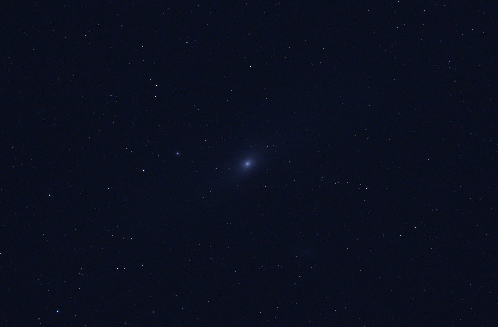
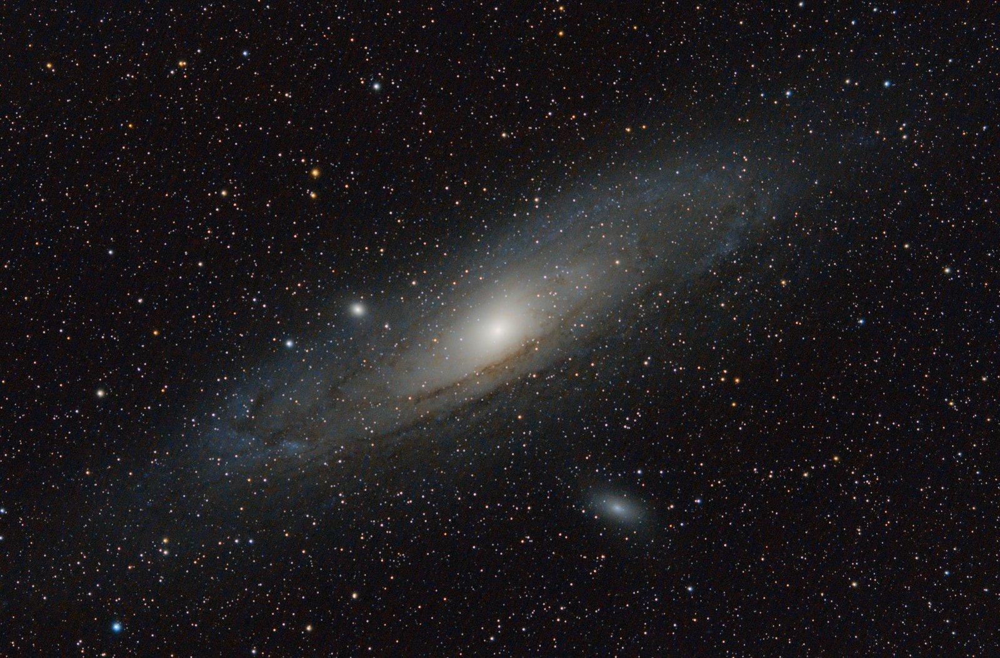
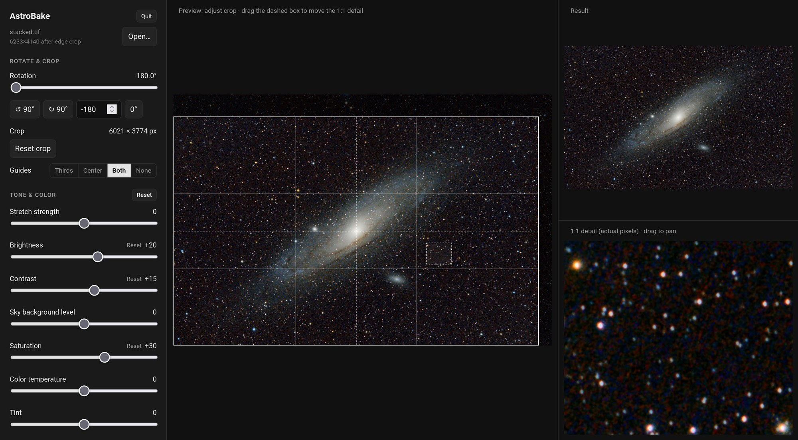

# Astrobake

Astrobake turns your raw deep-sky astrophotography images into finished pictures. Simply point it to your raw image folders and it automatically calibrates, aligns and stacks them. Then it crops the dead edges, removes background gradients, and balances and stretches the colors. Fine-tune the result with live sliders and a 1:1 preview.

| Raw photo                                                                                                         | After Astrobake (stacked and processed)                                                    |
| ----------------------------------------------------------------------------------------------------------------- | ------------------------------------------------------------------------------------------ |
|  |  |

<sub>The Andromeda Galaxy (M31) through a refractor. Left: one of the original light frames (photos), as the camera shows it. Right: after Astrobake stacking and processing with 100 light frames 80 calibration frames.</sub>

## Download

Grab the file for your computer from the [latest release](../../releases/latest).

| System                | File                     | To start                                                      |
| --------------------- | ------------------------ | ------------------------------------------------------------- |
| Windows               | `Astrobake-Windows.exe`  | Double-click it.                                              |
| macOS (Apple Silicon) | `Astrobake-macOS.zip`    | Unzip, move `Astrobake.app` to Applications, double-click it. |
| Linux                 | `Astrobake-Linux.tar.gz` | Extract, double-click `Astrobake`.                            |

Astrobake opens in your web browser. It takes a few seconds to start the first time.

### The first time you open it

Astrobake isn't signed with a paid developer certificate, so your system will warn you once:

- **Windows:** "Windows protected your PC". Click **More info**, then **Run anyway**.
- **macOS:** "Astrobake can't be opened" or "Apple could not verify…". Click **Done**, open **System Settings → Privacy & Security**, scroll down and click **Open Anyway** next to Astrobake. (On macOS 14 and older you can instead right-click the app and choose **Open**.)
- **Linux:** if double-clicking does nothing, right-click `Astrobake` → **Properties** → allow it to run as a program.

## Using it



Astrobake starts by asking what you'd like to do: **Stack & process**, **Stack only**, or **Process a stack** you already have.

### Stacking

1. Click **Stack & process** or **Stack only**, then choose the folder of light frames (your photos of the target, as camera raw files: `.CR2`, `.CR3`, `.NEF`, `.ARW`, `.RAF`, `.DNG` and so on). Folders of dark, flat and bias frames next to it, named like `darks`, `flats` and `bias`, are filled in automatically. You can also choose the folder that holds them all. Calibration frames are optional but help: darks remove hot pixels and amp glow, flats fix vignetting and dust shadows, and bias frames are used with the flats.
2. Optionally, use the menu next to each folder to use fewer frames for a quicker result. For lights it keeps the best ones, with the sharpest stars and darkest sky. Click **Stack**. You'll see each frame with the stars Astrobake found, then watch the stack build up as frames are added. About 100 frames from a 24-megapixel camera take 7 minutes on a 4-core laptop.

Astrobake leaves out frames with too few stars (clouds) or blurry, trailed stars. It also rejects satellite and plane trails pixel by pixel. The result is saved as `stacked.tif`, a linear 32-bit TIFF, in the folder that holds your lights folder. With **Stack & process** it then opens straight into processing.

Bayer-sensor cameras are supported, which covers nearly every DSLR and mirrorless camera. Fujifilm X-Trans and monochrome sensors are not. Darks should match the lights' exposure time, ISO and temperature.

### Processing

1. Click **Process a stack** and choose your stacked TIFF (16- or 32-bit), or drag it onto the page.
2. Adjust rotation, crop and the tone sliders. Every slider starts at 0, Astrobake's automatic setting. To check fine detail, drag the dashed box on the preview, or drag the 1:1 detail view itself.
3. Pick a **Size** and click **Export**. 50% often looks sharper than 100%, since most stacks hold less detail than their pixel count. Astrobake saves `<name>_processed_<width>x<height>.jpg` next to your original file. Exporting the same size again never overwrites it: the next one gets `_2`, and so on. Tick **Also save 16-bit TIFF** first if you want a copy for further editing. (For a dragged-in file, browsers don't reveal where it came from, so they go in your Downloads folder.)

**Start over** in the sidebar stops a stack in progress or closes the image and takes you back to the first screen. When you're done, click **Quit** or just close the browser tab.

Large stacks need roughly 6× their file size in memory (about 2 GB for a 24-megapixel image). Stacking needs about 3 GB, however many frames you have.

## Running from source

If you have Python 3.9+:

```
python3 astrobake.py
```

If any packages are missing it offers to install them. On Linux systems that don't allow that, it sets up a private virtual environment in `.venv` for you.

It also works from the command line without the UI, which is handy for batch jobs:

```
python3 astrobake.py stacked.tif --batch --stretch 4000 --rotate 12.5
```

The UI shows the exact command for whatever you've dialed in. Give it a folder instead of a TIFF to stack first:

```
python3 astrobake.py lights/ --stack-only         # just stacked.tif
python3 astrobake.py lights/ --batch              # stack, then process with default settings
python3 astrobake.py lights/ --darks ~/darks-iso800 --flats none
```

Run `python3 astrobake.py --help` for all options.

## Building the apps

GitHub Actions builds all three apps (see [.github/workflows/release.yml](.github/workflows/release.yml)). Push a version tag to publish a release with them attached:

```
git tag v1.0.0
git push origin v1.0.0
```

To build one locally: `pip install -r requirements.txt pyinstaller`, then `pyinstaller astrobake.spec`. The result goes in `dist/`.
