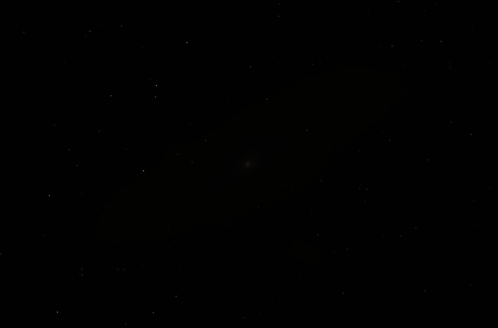

# Astrobake

Automatic processing for deep-sky stacks. Open the linear TIFF straight out of DeepSkyStacker or Siril and Astrobake crops the dead stacking edges, removes the background gradient, balances color and stretches it, with live sliders and a 1:1 preview to fine-tune the result.

| One photo | Stacked | After Astrobake |
|---|---|---|
|  |  |  |

<sub>The Andromeda Galaxy (M31) through a refractor. Left: one of the original photos, as the camera shows it. Middle: the stack straight out of DeepSkyStacker, as it looks in any image viewer. Right: the stack after Astrobake.</sub>

## Download

Grab the file for your computer from the [latest release](../../releases/latest). Nothing else to install.

| System | File | To start |
|---|---|---|
| Windows | `Astrobake-Windows.exe` | Double-click it. |
| macOS (Apple Silicon) | `Astrobake-macOS.zip` | Unzip, move `Astrobake.app` to Applications, double-click it. |
| Linux | `Astrobake-Linux.tar.gz` | Extract, double-click `Astrobake`. |

Astrobake opens in your web browser. It takes a few seconds to start the first time.

### The first time you open it

Astrobake isn't signed with a paid developer certificate, so your system will warn you once:

- **Windows:** "Windows protected your PC". Click **More info**, then **Run anyway**.
- **macOS:** "Astrobake can't be opened" or "Apple could not verify…". Click **Done**, open **System Settings → Privacy & Security**, scroll down and click **Open Anyway** next to Astrobake. (On macOS 14 and older you can instead right-click the app and choose **Open**.)
- **Linux:** if double-clicking does nothing, right-click `Astrobake` → **Properties** → allow it to run as a program.

## Using it


1. Click **Open stack…** and choose your stacked TIFF (16- or 32-bit), or drag it onto the page.
2. Adjust rotation, crop and the tone sliders. Every slider starts at 0, Astrobake's automatic setting. To check fine detail, drag the dashed box on the preview, or drag the 1:1 detail view itself.
3. Pick a **Size** and click **Export**. 50% often looks sharper than 100%, since most stacks hold less detail than their pixel count. Astrobake saves `<name>_processed.jpg` next to your original file. Tick **Also save 16-bit TIFF** first if you want a copy for further editing. (For a dragged-in file, browsers don't reveal where it came from, so they go in your Downloads folder.)

When you're done, click **Quit** or just close the browser tab.

Large stacks need roughly 6× their file size in memory (about 2 GB for a 24-megapixel image).

## Running from source

If you have Python 3.9+:

```
python3 astrobake.py
```

If any packages are missing it offers to install them. On Linux systems that don't allow that, it sets up a private virtual environment in `.venv` for you.

It also works from the command line without the UI, which is handy for batch jobs:

```
python3 astrobake.py stacked.tif --batch --stretch 4000 --rotate 12.5
```

The UI shows the exact command for whatever you've dialed in. Run `python3 astrobake.py --help` for all options.

## Building the apps

GitHub Actions builds all three apps (see [.github/workflows/release.yml](.github/workflows/release.yml)). Push a version tag to publish a release with them attached:

```
git tag v1.0.0
git push origin v1.0.0
```

To build one locally: `pip install -r requirements.txt pyinstaller`, then `pyinstaller astrobake.spec`. The result goes in `dist/`.
